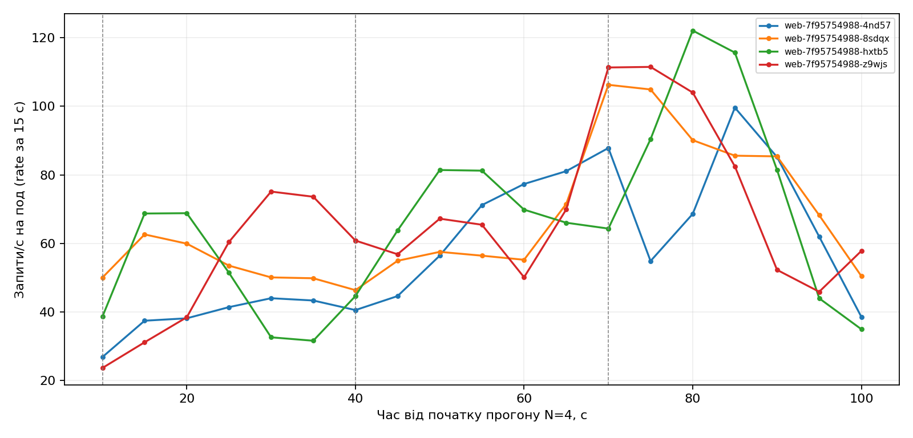
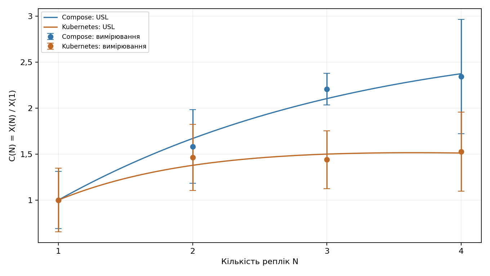
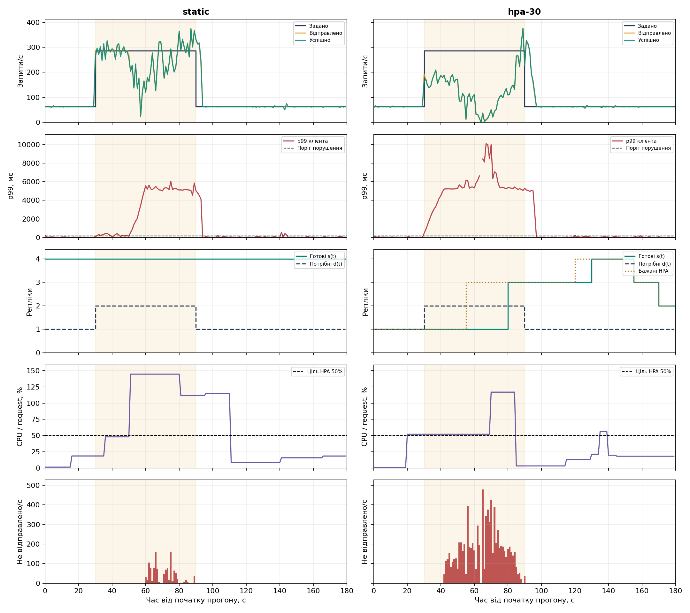
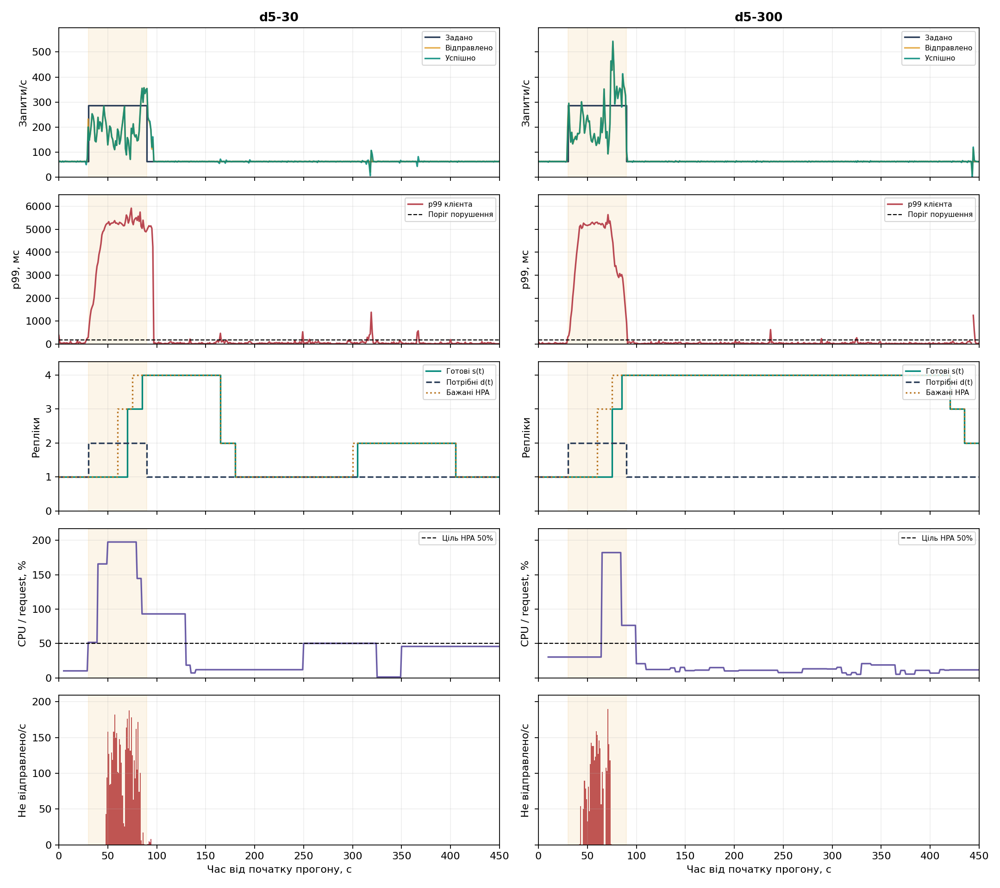

# Лабораторна робота 3. Сервіс у Kubernetes з автомасштабуванням і без нього

Дьяченко Валерія, ЗК-61мп. Варіант 7.

## Мета роботи

Перенести сервіс вакцинацій у Kubernetes, перевірити роботу з однією та кількома репліками й порівняти постійні чотири репліки з HPA. Для додаткового завдання Д5 порівняти вікна зменшення кількості реплік 30 і 300 секунд.

## 1. Сервіс і середовище

Було використано сервіс із попередньої роботи: API на Python, база PostgreSQL і метрики Prometheus. Клієнт звертається до запису вакцинації за його ідентифікатором. Перед навантаженням було створено 100 записів, для читання обрано один із них.

Кластер kind складається з одного керівного і двох робочих вузлів. Версія Kubernetes — 1.32.2. Керівному вузлу задано мітку `role=infra`; на ньому розміщено базу та моніторинг. Web працює на робочих вузлах. Docker Desktop надавав середовищу 8 логічних CPU і 3 554 906 112 байтів пам’яті, тобто приблизно 3,31 ГіБ. Значення та список вузлів збережено в `results/machine.json`.

HTTP-генератор працював в окремому Linux-контейнері на тому самому комп’ютері. Використано Python 3.11.2 і aiohttp 3.12.15. Запити йшли через `host.docker.internal:8080`, тобто через опублікований порт поточного стенда. Керування кластером і звернення до Prometheus виконувалися з Windows. У сирих файлах збережено платформу генератора та адресу запиту.

## 2. Розгортання бази та web

PostgreSQL розгорнуто як StatefulSet із PersistentVolumeClaim і headless Service `db`. Для розміщення на вузлі `role=infra` використано `nodeSelector` і `tolerations`. Кількість з’єднань бази обмежено значенням `max_connections=100`. Схему створює окремий Job міграції.

Пароль береться з локального `.env` і передається через Secret. У web використано `secretKeyRef`; пароль не записується в ConfigMap чи образ. Адресу бази та `DB_POOL_SIZE=15` задано через ConfigMap. Пул одного web-пода відкриває не більше 15 з’єднань. Ім’я пода надходить у `POD_NAME` через Downward API та повертається в заголовку `X-Pod`.

Для web створено Deployment без поля `replicas` і Service типу NodePort. Кількість реплік змінюється командами `kubectl scale` або HPA. Запит CPU одного пода — `500m`, ліміт CPU — 1 ядро, ліміт пам’яті — 512 MiB. Усередині контейнера працює один серверний процес.

Readiness перевіряє `/healthz`, який звертається до бази: тайм-аут 3 с, період 5 с, поріг 3 невдалі перевірки. Liveness використовує `/livez` без звернення до бази. Перед зупинкою передбачено `preStop.sleep` на 5 с, загальний `terminationGracePeriodSeconds` — 15 с.

Порти NodePort 30080 і 30090 зіставлено з портами хоста 8080 для API та 9090 для Prometheus.

Команда розгортання з папки проєкту:

```powershell
powershell -ExecutionPolicy Bypass -File .\deploy.ps1
```

Фіксована серія та профілі запускаються окремо. Другий запуск використовує збережені ємності й не повторює перший етап:

```powershell
powershell -ExecutionPolicy Bypass -File .\run-linux.ps1
powershell -ExecutionPolicy Bypass -File .\run-linux.ps1 -ProfilesOnly
```

Видалення кластера після збереження результатів:

```powershell
powershell -ExecutionPolicy Bypass -File .\delete.ps1
```

## 3. Перевірка CRUD і збереження даних

Було пройдено повний цикл CRUD. Створення повернуло 201, читання та заміна — 200, видалення — 204. У тестового запису з ідентифікатором 405 номер дози змінено з 1 на 2.

Перед видаленням запису под `db-0` було видалено командою `kubectl delete pod`. Після його відновлення читання повернуло 200 і номер дози 2. Отже, заміна пода бази не видалила запис із тому. Ім’я пода web записано для кожної відповіді. Підтвердження міститься в `results/checks.json`.

## 4. Моніторинг

Prometheus збирає метрики з інтервалом 5 с і знаходить поди web через Kubernetes. cAdvisor через kubelet надає CPU та лічильники CFS. kube-state-metrics надає ряди готових і бажаних реплік, postgres-exporter — метрики бази. Для metrics-server задано `--kubelet-insecure-tls`; його встановлення входить у сценарій розгортання.

Перед серією було підтверджено доступність web і PostgreSQL, ряд готових реплік, лічильники HTTP та CFS. Команда `kubectl top pods` повернула дані: зокрема, для web — 11m CPU і 53 MiB пам’яті, для бази — 23m і 44 MiB. Це перевірка доступності метрик перед навантаженням, а не показники на максимумі. Результати збережено в `results/monitoring-checks.json` і `results/checks.json`.

У фіксованій серії збережено ряди запитів для кожного пода. На чотирьох репліках у них є всі чотири імені подів. Дані CFS отримано для всіх подів кожного N. Під час профілів збережено окремі часові ряди `ready`, `desired` і CPU.

## 5. Метод вимірювання

Для варіанта 7 найбільша кількість реплік R=4. Генератор використовує 8·R=32 постійні канали з одним запитом в обробці на канал. Після кожних 100 відправлених спроб з’єднання замінюється. Через keep-alive запити одного з’єднання потрапляють до того самого пода.

Перед кожним фіксованим прогоном виконано окремий прогрів 60 с на 100 запитах/с. Основний профіль починається з 10 с на 200 запитах/с. Далі йдуть сходинки по 30 с: 200, 400, 600 запитів/с і вище, якщо прогін ще не зупинено. Для таблиць беруться останні 20 с сходинки. Прогін зупиняється після двох послідовних сходинок із досягнутою швидкістю нижче 90% цілі. У цій серії всі чотири прогони завершилися після рівня 600.

Для кожної спроби записуються запланований час, фактична відправка, завершення, HTTP-код, под і тип помилки. Відправлений запит має повні 5 с тайм-ауту. Клієнтська затримка рахується від запланованої відправки, тому включає очікування в генераторі; вона може перевищувати 5 с. Серверна гістограма цього очікування не включає.

Спроба, яка чекала відправлення понад 5 с, не надсилається й записується окремо як `dispatch_lag`. Такі спроби не є HTTP-відповідями й не додаються до мережевих тайм-аутів. Вони враховані окремою колонкою «Не відправлено». p99 обчислюється для відправлених спроб, включно з їхнім очікуванням до відправки. Дані всіх невідправлених спроб залишаються в сирих журналах.

X(N) — найбільша середня швидкість успішних відповідей серед сходинок. Розкид — стандартне відхилення посекундної кількості успішних відповідей у вибраному вікні. Це не довірчий інтервал. Графіки швидкості використовують час завершення, тому відповіді на запити зі стрибка можуть потрапляти на початок спаду.

## 6. Фіксована кількість реплік

| N | X(N), запитів/с | Розкид | Сходинка | p99 клієнта, мс | p99 сервера, мс | CFS середнє, % | CFS максимум, % | I |
|---:|---:|---:|---:|---:|---:|---:|---:|---:|
| 1 | 208,200 | 72,046 | 600 | 5572,056 | 397,500 | 4,667 | 4,667 | 1,000 |
| 2 | 304,800 | 75,055 | 600 | 5259,000 | 247,212 | 6,132 | 6,159 | 1,013 |
| 3 | 299,650 | 65,788 | 400 | 5197,973 | 233,059 | 2,971 | 3,715 | 1,054 |
| 4 | 318,200 | 89,505 | 400 | 5216,269 | 241,369 | 0,770 | 1,429 | 1,048 |

Друга репліка збільшила виміряну швидкість приблизно на 46,4%. Різниця між двома та трьома репліками становить близько 1,7% і мала порівняно з розкидом. Чотири репліки дали найбільше значення цієї серії — 318,2 успішного запиту/с.

Останньою сходинкою всюди була ціль 600 запитів/с. Відношення досягнутого до заданого становили 0,347; 0,508; 0,399 і 0,389 для N=1–4. Вони нижчі за 0,9, тому за критерієм останньої сходинки точки не відкидаються. Однак цей критерій не перевіряє, чи генератор відправив усю задану кількість.

### Обмеження фактичної відправки

| N | Ціль на найкращій сходинці, запитів/с | Відправлено/с | p95 очікування відправки, мс | Не відправлено у розрахунковому вікні |
|---:|---:|---:|---:|---:|
| 1 | 600 | 208,200 | 4997,056 | 7854 |
| 2 | 600 | 304,800 | 4996,570 | 5954 |
| 3 | 400 | 299,650 | 4988,268 | 969 |
| 4 | 400 | 318,200 | 4984,547 | 1086 |

На цих сходинках не було HTTP-помилок, тайм-аутів відправлених запитів чи помилок з’єднання. Проте фактична відправка не дорівнювала цілі. Вимогу точного відтворення заданої інтенсивності на високих сходинках не виконано. Тому X(N) описує виконаний прогін із цією моделлю з’єднань і маршрутом, а не окремо встановлену максимальну швидкість застосунку.

За часовими інтервалами відправлених запитів кожні 0,1 с було відновлено кількість зайнятих каналів. У вікнах X(N) середнє становило 31,85–31,95 із 32 каналів. Середній час після відправки становив приблизно 153,2; 105,0; 106,5 і 100,1 мс для N=1–4. Практично всі канали були зайняті, а наступні запити чекали їхнього звільнення. Це пояснює механізм накопичення черги, але саме по собі не відокремлює час мережі від часу web і бази.

## 7. Розподіл запитів і CFS

Дисбаланс обчислено як I=X_max/X_avg. На найкращих сходинках для N=2–4 він становив 1,013; 1,054 і 1,048. Отже, найбільш завантажений под мав приблизно на 1,3–5,4% більше відповідей, ніж середній под. Рівність не є точною через закріплення keep-alive з’єднань за подами та їх заміну після 100 спроб.

| N | Под | Запитів/с | p99 сервера, мс | CFS, % |
|---:|---|---:|---:|---:|
| 2 | web-7f95754988-z9wjs | 150,450 | 246,574 | 6,159 |
| 2 | web-7f95754988-hxtb5 | 154,350 | 247,780 | 6,105 |
| 3 | web-7f95754988-z9wjs | 92,400 | 157,929 | 1,972 |
| 3 | web-7f95754988-4nd57 | 105,250 | 225,430 | 3,226 |
| 4 | web-7f95754988-4nd57 | 74,250 | 354,167 | 0,604 |
| 4 | web-7f95754988-z9wjs | 83,400 | 191,306 | 1,049 |

У кожній парі спочатку наведено найменш, потім найбільш завантажений под. Менше запитів не завжди означає менший p99: на чотирьох репліках найменш завантажений под мав більший серверний p99.

Частку CFS обчислено як приріст `container_cpu_cfs_throttled_periods_total`, поділений на приріст `container_cpu_cfs_periods_total`. Через частоту оновлення cAdvisor взято точки, що обрамляють потрібне вікно. Фактичні інтервали ширші за 20 с, тому ці частки є наближенням до стану навколо сходинки. Початок, кінець і прирости збережено в `cfs_evidence` та наведено в `RESULTS.md`. Значення не слід вважати точним виміром лише всередині останніх 20 с.



На графіку показано серверний `rate` за 15 с з кроком 5 с. Вертикальні лінії позначають зміни рівня навантаження; вісь часу відраховується від початку сирого прогону N=4.

## 8. Модель масштабування і Compose

Відносну швидкість обчислено як C(N)=X(N)/X(1). Для підбору USL використано перетворення N/C(N)−1=σ·(N−1)+κ·N·(N−1) і метод найменших квадратів із невід’ємними параметрами. Обидві отримані оцінки додатні, тому граничне обнулення тут не застосовувалося.

| N | X(N), Compose | C(N), Compose | X(N), Kubernetes | C(N), Kubernetes |
|---:|---:|---:|---:|---:|
| 1 | 270,333 | 1,000 | 208,200 | 1,000 |
| 2 | 427,800 | 1,582 | 304,800 | 1,464 |
| 3 | 596,733 | 2,207 | 299,650 | 1,439 |
| 4 | 633,867 | 2,345 | 318,200 | 1,528 |

Для Kubernetes отримано σ=0,353561, κ=0,048736 і N*=√((1−σ)/κ)≈3,642. Для Compose з другої роботи збережено σ=0,167020, κ=0,015230 і N*≈7,396. Останнє значення лежить поза виміряними 1–4 репліками й є прогнозом моделі.



На графіку розкид нормовано діленням на X(1) відповідного стенда; це не довірчі межі параметрів. Значення N*≈3,64 не доводить, що практичний оптимум сервера дорівнює чотирьом подам: є значний розкид і пропуски відправки. Compose та Kubernetes відрізняються моделлю з’єднань, тривалістю сходинок, лімітами CPU і середовищем виконання генератора. Тому різницю таблиці не можна приписати лише Kubernetes.

## 9. Профіль навантаження і HPA

Фонову інтенсивність обчислено як 0,3·208,2=62,46 запиту/с. Рівень стрибка — min(2·208,2; 0,9·318,2)=286,38 запиту/с. Основний профіль: 30 с фону, 60 с стрибка і 90 с фону, загалом 180 с. У static весь час працюють чотири репліки.

HPA має межі 1–4 репліки та ціль CPU 50% від `requests.cpu=500m`. Це відповідає в середньому 250m CPU на под. Бажана кількість визначається округленням угору добутку поточної кількості реплік на відношення виміряного використання до цільового, з урахуванням допуску 0,1 та меж 1–4. Перед кожним прогоном очікується 60 с стабільного стану з однією реплікою. Бажану кількість взято з метрики HPA, а готову — з метрики Deployment.

У Д5 виконано два окремі прогони з вікнами зменшення 30 і 300 с. Початкові ділянки такі самі, але завершальний фон триває 360 с. Обидва прогони мають T=450 с.

## 10. Еластичність і повний облік спроб

Потрібна кількість d(t) — найменше N, для якого виміряне X(N) не нижче цілі. Для цього профілю потрібна одна репліка на фоні й дві під час стрибка. s(t) — фактично готові репліки. θ_U та θ_O — частки часу з нестачею й надлишком; a_U та a_O — середня кількість відсутніх і зайвих реплік. W — сума готових реплік за всі секунди, у под-секундах. Ці оцінки залежать від виміряних X(N), тому успадковують обмеження фіксованої серії.

| Режим | T, с | θ_U | θ_O | a_U | a_O | W, под·с | Секунд понад поріг p99 |
|---|---:|---:|---:|---:|---:|---:|---:|
| static | 180 | 0,000 | 1,000 | 0,000 | 2,667 | 720 | 62 |
| hpa-30 | 180 | 0,278 | 0,556 | 0,278 | 1,139 | 395 | 68 |
| d5-30 | 450 | 0,089 | 0,467 | 0,089 | 0,811 | 835 | 83 |
| d5-300 | 450 | 0,100 | 0,833 | 0,100 | 2,344 | 1520 | 67 |

Поріг порушення дорівнює подвоєному p99 початкового фону static: 182,618 мс. Порушення пораховано за секундними значеннями p99. Секунда без відправлених завершених спроб не має p99 і не вважається доказом відсутності затримки.

| Режим | Заплановано спроб | Успішно 2xx | HTTP не 2xx | Тайм-аути | Помилки з’єднання | Не відправлено |
|---|---:|---:|---:|---:|---:|---:|
| static | 24679 | 23505 | 0 | 0 | 0 | 1174 |
| hpa-30 | 24679 | 16243 | 0 | 10 | 0 | 8426 |
| d5-30 | 41543 | 37165 | 0 | 0 | 0 | 4378 |
| d5-300 | 41543 | 38651 | 0 | 0 | 0 | 2892 |

Ця таблиця включає всі спроби, заплановані всередині профілю, і їхні завершення, навіть якщо завершення настало одразу після T. Невідправлені спроби становили 4,76%; 34,14%; 10,54% і 6,96% відповідно. Усі вони належать до запланованого часу стрибка. У hpa-30 також було 10 тайм-аутів після фактичної відправки, без HTTP-відповіді. Вони завершилися приблизно на 67,45–70,74 с прогону; за рядом ready тоді ще була одна готова репліка. Даних для встановлення точної причини кожного тайм-ауту немає.

На самому 60-секундному стрибку середня швидкість успішних завершень становила 250,87 запиту/с для static і 125,82 для hpa-30. p99 цього інтервалу — 5245,59 і 6393,02 мс відповідно. Відповіді, що завершилися вже після 90 с, не входять у ці середні швидкості; вони враховані в повному обліку спроб вище.

## 11. Час реакції HPA

Стрибок починається на 30-й секунді й закінчується на 90-й. Час зміни desired, готовності максимуму та критерію p99 рахується від початку стрибка. Час зменшення — від його кінця. Через крок збору метрик 5 с події мають відповідну часову дискретність.

| Подія | hpa-30 | d5-30 | d5-300 |
|---|---:|---:|---:|
| Перша зміна бажаної кількості, с | 25 | 30 | 30 |
| Готовність найбільшої за прогін кількості під час стрибка, с | не досягнуто | 55 | 55 |
| Перший інтервал 10 с нижче порогу p99, с | 0 | 0 | 0 |
| Перше зменшення готових реплік після стрибка, с | 65 | 75 | 330 |

У hpa-30 чотири готові репліки з’явилися на 130-й секунді прогону, тобто через 100 с від початку стрибка та через 40 с після його кінця. Тому для самої ділянки стрибка записано «не досягнуто». У двох прогонах Д5 чотири репліки стали готовими на 85-й секунді, ще до кінця стрибка.

Формальний поріг критерію p99 дорівнює 1,2·5245,585=6294,702 мс. Перші 10 секунд стрибка в кожному HPA-прогоні були нижче нього, тому правило дає 0 с. Це не означає миттєвого відновлення: поріг уже високий через затримки static, а пізніше p99 знову погіршується. Саме тому поряд наведено швидкість, пропуски та кількість секунд порушення нижчого фонового порогу.



На графіках static і hpa-30 однакові шкали часу та відповідних показників. Додано фактичну відправку й невідправлені спроби. Помаранчева ділянка позначає стрибок. CPU показано у відсотках від запиту 500m, а не від ліміту одного ядра.

## 12. Додаткове завдання Д5

За однакових 450 с вікно 30 с використало 835 под-секунд, а вікно 300 с — 1520. Вікно 30 с дало приблизно на 45,1% менші витрати под-секунд. Частка часу з надлишком реплік становила 46,7% і 83,3% відповідно.

Перше зменшення після кінця стрибка відбулося через 75 с для вікна 30 с і через 330 с для вікна 300 с. Наприкінці d5-300 ще залишалося дві готові репліки; повернення до однієї до завершення профілю не відбулося. У d5-30 повернення до однієї було на 180-й секунді, але пізніше відбувся ще один підйом до двох реплік. Його видно в ready і desired; тому витрати цього прогону не зводяться лише до першого зменшення.

У d5-300 було менше невідправлених спроб — 2892 проти 4378, і менше секунд понад поріг — 67 проти 83. Проте ці відмінності не можна пояснити лише вікном зменшення: прогони виконувалися окремо, вже на стрибку мали різні швидкості та посекундні значення CPU. Вікно scaleDown насамперед визначає, як довго зберігатимуться зайві репліки після зниження навантаження.



## Висновок

Було перевірено CRUD, збереження запису після заміни пода PostgreSQL і доступність метрик. У серії на 1–4 репліках виміряно 208,2; 304,8; 299,65 і 318,2 успішного запиту/с. Найбільший приріст дав перехід від однієї до двох реплік. Подальші зміни менші відносно розкиду. На найкращих сходинках розподіл між подами був близьким до рівного, а дані CFS отримано для всіх подів.

Головне обмеження вимірювання — відставання фактичної відправки від цілі при зайнятих 32 каналах. Значна частина запланованих спроб не була відправлена. Тому немає підстав називати X(N) чистою максимальною пропускною здатністю web або приписувати обмеження виключно PostgreSQL чи CPU. Отримані σ, κ та N* описують цю серію всієї схеми з’єднань, мережі й сервісу.

HPA зменшив витрати з 720 до 395 под-секунд у порівнянні зі static, приблизно на 45,1%, але якість обслуговування була гіршою: більше пропусків відправки, 10 тайм-аутів і нижча швидкість під час стрибка. Це економія ресурсів із погіршенням результату, а не рівноцінна заміна чотирьох постійних реплік.

У Д5 довше вікно утримувало більше готових подів після спаду й витрачало більше под-секунд. Вікно 30 с було економнішим, проте окремий прогін із 300 с мав менше пропусків. За одним прогоном кожного режиму та наявного відставання генератора цього недостатньо для універсального висновку про найкраще вікно.

Повні числові таблиці, фактичні інтервали CFS та облік спроб за фазами наведено в [RESULTS.md](RESULTS.md). Сирі дані залишаються в `results`. Скрипт `report.py` відтворює числові таблиці та графіки; текст цього звіту ним не формується.
