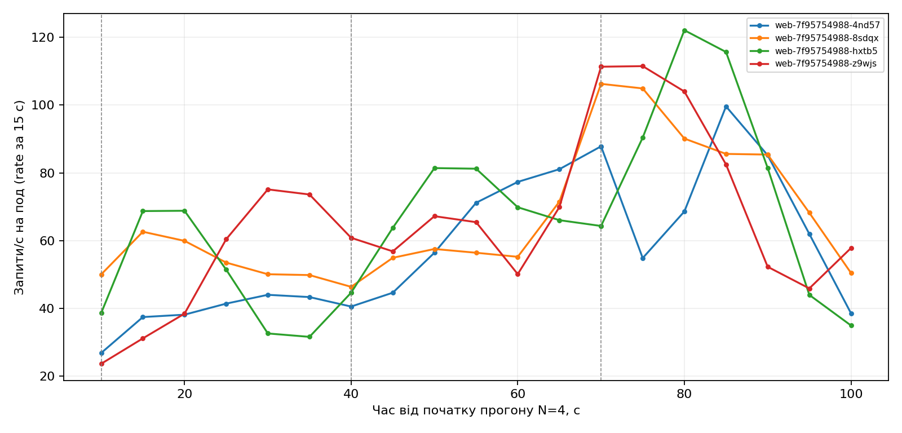
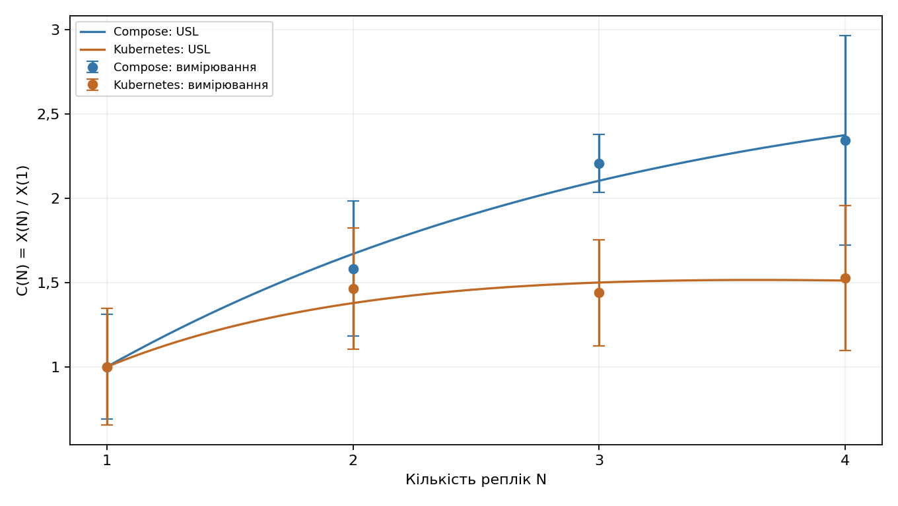
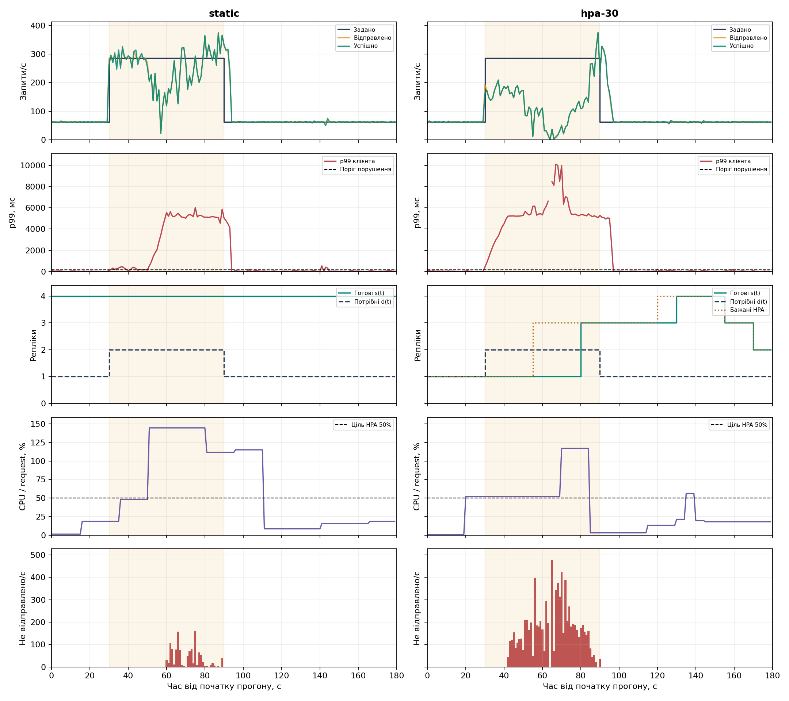
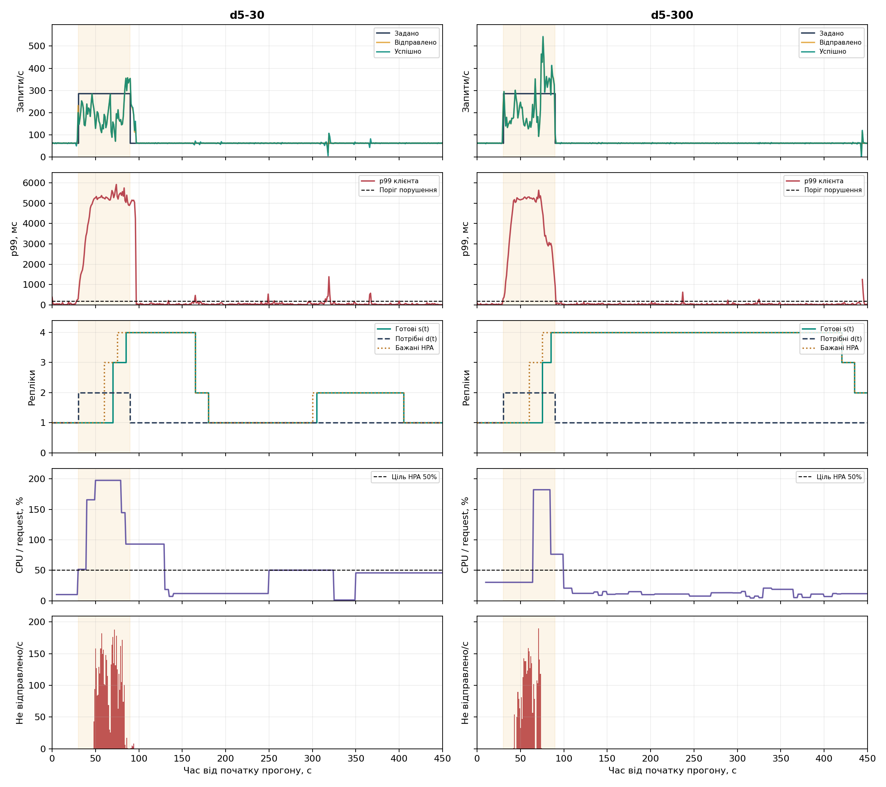

# Лабораторна робота 3. Сервіс у Kubernetes з автомасштабуванням і без нього

Варіант 7. Дьяченко Валерія, група ЗК-61мп.

Дисципліна «Високопродуктивні розподілені обчислювальні системи».

## Мета роботи

Перенести сервіс записів про вакцинацію в Kubernetes, виміряти його роботу на одній і кількох репліках та порівняти чотири постійні репліки з автоматичним масштабуванням (HPA). У додатковому завданні Д5 порівняти два вікна зменшення кількості реплік: 30 і 300 секунд.

## 1 Сервіс і середовище

Я взяла сервіс із попередньої роботи: API на Python, базу PostgreSQL і метрики Prometheus. Клієнт читає запис про вакцинацію за його ідентифікатором. Перед навантаженням я створила 100 записів, а для читання в усіх прогонах використала один із них.

Кластер зроблено в kind: один керівний вузол і два робочі. Керівному вузлу я дала мітку `role=infra`, на ньому працюють база та моніторинг. Web працює на двох робочих вузлах. Значення ресурсів і список вузлів збережено в `results/machine.json`.

| Параметр | Значення |
|---|---|
| Кластер | kind: 1 керівний і 2 робочі вузли |
| Версія Kubernetes | 1.32.2 |
| Docker Desktop | 8 логічних CPU, 3 554 906 112 байтів пам’яті (близько 3,31 ГіБ) |
| Запит і ліміт CPU одного web | 500m і 1 ядро |
| Ліміт пам’яті одного web | 512 MiB |
| Процесів сервісу в контейнері | 1 |
| Пул з’єднань з базою на один web | до 15 |
| `max_connections` у PostgreSQL | 100 |
| Генератор | Python 3.11.2, aiohttp 3.12.15, окремий Linux-контейнер |
| Канали генератора | 32 (8·R при R = 4) |
| Сценарій | читання одного запису за ідентифікатором |
| Кластер і генератор | на одному комп’ютері |

Генератор надсилав запити через `host.docker.internal:8080`, тобто через опублікований порт стенда. Кластером я керувала, а до Prometheus звертались із Windows. Платформу генератора й адресу запиту збережено в сирих файлах.

## 2 Розгортання бази та web

PostgreSQL працює як StatefulSet із томом (PersistentVolumeClaim) і headless Service `db`. Щоб база опинилась на вузлі `role=infra`, використано `nodeSelector` і `tolerations`. Кількість з’єднань бази обмежено значенням `max_connections=100`. Схему створює окремий Job.

Пароль береться з локального `.env` і потрапляє в Secret. Web читає його через `secretKeyRef`, тож у ConfigMap чи в образі пароля немає. Адресу бази й `DB_POOL_SIZE=15` задано через ConfigMap, тому один под відкриває до 15 з’єднань. Ім’я пода передається у змінну `POD_NAME` через Downward API й повертається в заголовку `X-Pod`. За цим заголовком видно, який саме под відповів.

Для web створено Deployment без поля `replicas` і Service типу NodePort. Кількість реплік змінюється командою `kubectl scale` або HPA. Запит CPU одного пода становить `500m`, ліміт — 1 ядро, ліміт пам’яті — 512 MiB. Усередині контейнера працює один серверний процес.

Готовність (readiness) перевіряє `/healthz`, який звертається до бази: тайм-аут 3 с, період 5 с, поріг 3 невдалі перевірки. Перевірка роботи процесу (liveness) використовує `/livez` без звернення до бази. Перед зупинкою пода є пауза `preStop.sleep` на 5 с, а на все завершення відведено `terminationGracePeriodSeconds` 15 с.

NodePort 30080 і 30090 зіставлено з портами комп’ютера: 8080 для API та 9090 для Prometheus.

Розгортання запускається однією командою з папки проєкту:

```powershell
powershell -ExecutionPolicy Bypass -File .\deploy.ps1
```

Фіксована серія й профілі навантаження запускаються окремо. Другий запуск бере вже збережені ємності й не повторює перший етап:

```powershell
powershell -ExecutionPolicy Bypass -File .\run-linux.ps1
powershell -ExecutionPolicy Bypass -File .\run-linux.ps1 -ProfilesOnly
```

Після збереження результатів кластер видаляється:

```powershell
powershell -ExecutionPolicy Bypass -File .\delete.ps1
```

## 3 Перевірка CRUD і збереження даних

Я пройшла повний цикл CRUD. Створення повернуло 201, читання та заміна — 200, видалення — 204. У тестового запису з ідентифікатором 405 номер дози я змінила з 1 на 2.

Перед видаленням запису я видалила под `db-0` командою `kubectl delete pod`. Після його відновлення читання повернуло 200 і номер дози 2. Тобто заміна пода бази не стерла запис із тому. Ім’я пода web записано для кожної відповіді. Підтвердження лежить у `results/checks.json`.

## 4 Моніторинг

Prometheus збирає метрики кожні 5 с і знаходить поди web через Kubernetes. cAdvisor через kubelet дає CPU та лічильники CFS, kube-state-metrics — ряди готових і бажаних реплік, postgres-exporter — метрики бази. Для metrics-server задано `--kubelet-insecure-tls`, а його встановлення входить у сценарій розгортання.

Перед серією я переконалась, що доступні web і PostgreSQL, ряд готових реплік, лічильники HTTP та CFS. Команда `kubectl top pods` повернула дані: для web 11m CPU і 53 MiB пам’яті, для бази 23m і 44 MiB. Це лише перевірка того, що метрики працюють до навантаження, а не показники на максимумі. Результати збережено в `results/monitoring-checks.json` і `results/checks.json`.

CFS показує, у якій частці періодів процесор пода був обмежений лімітом. Простіше кажучи, чи впирається под у свій ліміт CPU.

У фіксованій серії збережено ряди запитів для кожного пода. На чотирьох репліках у них є всі чотири імені. Дані CFS отримано для всіх подів при кожному N. Під час профілів окремо збережено ряди `ready`, `desired` і CPU.

## 5 Як я вимірювала

Для варіанта 7 найбільша кількість реплік R = 4. Генератор тримає 8·R = 32 постійні канали, і на кожному каналі в обробці лише один запит. Після кожних 100 відправлених спроб з’єднання замінюється. Через keep-alive запити одного з’єднання потрапляють до того самого пода, тому навантаження між подами не обов’язково ділиться порівну.

Перед кожним фіксованим прогоном я робила прогрів 60 с на 100 запитах/с. Основний профіль починається з 10 с на 200 запитах/с, далі йдуть сходинки по 30 с: 200, 400, 600 запитів/с і вище, якщо прогін не зупинено. Для таблиць беруться останні 20 с кожної сходинки. Прогін зупиняється після двох сходинок поспіль, на яких досягнуто менше 90% заданої швидкості. У цій серії всі чотири прогони завершились після рівня 600.

Для кожної спроби записуються запланований час, фактична відправка, завершення, HTTP-код, под і тип помилки. Тайм-аут відправленого запиту становить 5 с. Затримку клієнта я рахую від запланованого моменту, тому в неї входить і час очікування в самому генераторі, і вона може бути більшою за 5 с. Серверна гістограма цього очікування не враховує.

Якщо спроба чекала відправки довше за 5 с, вона не надсилається й записується окремо (`dispatch_lag`). Це не HTTP-відповідь і не мережевий тайм-аут, тому такі спроби винесено в окрему колонку «Не відправлено». p99 рахується за відправленими спробами разом із їхнім очікуванням до відправки. Усі невідправлені спроби лишаються в сирих журналах.

X(N) — це найбільша середня швидкість успішних відповідей серед сходинок. Розкид — стандартне відхилення посекундної кількості успішних відповідей у вибраному вікні, тобто не довірчий інтервал. Графіки швидкості будуються за часом завершення, тож відповіді на запити зі стрибка можуть потрапляти на початок спаду.

## 6 Фіксована кількість реплік

| N | X(N), запитів/с | Розкид | Сходинка | p99 клієнта, мс | p99 сервера, мс | CFS середнє, % | CFS максимум, % | I |
|---:|---:|---:|---:|---:|---:|---:|---:|---:|
| 1 | 208,200 | 72,046 | 600 | 5572,056 | 397,500 | 4,667 | 4,667 | 1,000 |
| 2 | 304,800 | 75,055 | 600 | 5259,000 | 247,212 | 6,132 | 6,159 | 1,013 |
| 3 | 299,650 | 65,788 | 400 | 5197,973 | 233,059 | 2,971 | 3,715 | 1,054 |
| 4 | 318,200 | 89,505 | 400 | 5216,269 | 241,369 | 0,770 | 1,429 | 1,048 |

Друга репліка збільшила швидкість приблизно на 46,4% (304,8 / 208,2 = 1,464). Між двома і трьома репліками різниця близько 1,7%, а це мало порівняно з розкидом. Найбільше значення серії дали чотири репліки: 318,2 успішного запиту/с.

Останньою сходинкою в усіх прогонах була ціль 600 запитів/с. Досягнуте відносно заданого становило 0,347; 0,508; 0,399 і 0,389 для N = 1–4. Усе це нижче за 0,9, тому за критерієм останньої сходинки жодну точку не відкинуто. Але цей критерій не показує, чи генератор узагалі відправив усе, що мав.

### Чи відправляв генератор стільки, скільки задано

| N | Ціль на найкращій сходинці, запитів/с | Відправлено/с | p95 очікування відправки, мс | Не відправлено у вікні розрахунку |
|---:|---:|---:|---:|---:|
| 1 | 600 | 208,200 | 4997,056 | 7854 |
| 2 | 600 | 304,800 | 4996,570 | 5954 |
| 3 | 400 | 299,650 | 4988,268 | 969 |
| 4 | 400 | 318,200 | 4984,547 | 1086 |

На цих сходинках не було ні HTTP-помилок, ні тайм-аутів відправлених запитів, ні помилок з’єднання. Проте відправлялось менше, ніж задано, і вимогу точно відтворювати задану інтенсивність на високих сходинках я не виконала. Тому X(N) тут описує саме цей прогін, цю модель з’єднань і цей маршрут, а не окремо встановлену максимальну швидкість застосунку.

Далі я за часом відправки та завершення запитів відновила, скільки каналів було зайнято (кожні 0,1 с). У вікнах X(N) у середньому було зайнято 31,85–31,95 із 32 каналів. Середній час після відправки становив приблизно 153,2; 105,0; 106,5 і 100,1 мс для N = 1–4. Тобто майже всі канали були зайняті, а нові запити чекали, поки котрийсь звільниться. Звідси видно, як утворюється черга, але не видно, скільки часу йде на мережу, а скільки на web і базу.

Ці числа добре збігаються із законом Літтла для генератора з фіксованою кількістю каналів: швидкість приблизно дорівнює 32, поділеному на середній час після відправки. Для N = 1–4 виходить близько 209; 305; 300 і 320 запитів/с, а виміряно 208,2; 304,8; 299,65 і 318,2. Отже, X(N) залежить від кількості каналів і від часу відповіді. Від однієї до двох реплік цей час зменшився з 153 до 105 мс, а далі майже не змінювався (100–107 мс). Це схоже на якийсь спільний ресурс, який не росте разом із кількістю подів web: базу, мережевий шлях через `host.docker.internal` або ресурси віртуальної машини Docker Desktop. За даними цієї роботи сказати, що саме, я не можу. Невелика частка CFS (0,8–6,2%) показує, що швидкість обмежував не ліміт CPU подів web. Ще Docker Desktop мав лише близько 3,31 ГіБ пам’яті на три вузли, Prometheus, базу, чотири web із лімітом 512 MiB і генератор. Чи не вистачало пам’яті, я не перевіряла, тож це лише припущення. Закон Літтла я навела як пояснення, а не як окрему перевірку.

## 7 Розподіл запитів і CFS

Дисбаланс рахується як I = X_max / X_avg, тобто швидкість найбільш завантаженого пода, поділена на середню швидкість на под. Якщо запити ділились би порівну, було б 1. Приклад для N = 4: середня швидкість на под 318,2 / 4 = 79,55, найбільш завантажений под обробляв 83,4, тож I = 83,4 / 79,55 = 1,048.

На найкращих сходинках для N = 2–4 дисбаланс становив 1,013; 1,054 і 1,048. Тобто найбільш завантажений под отримував приблизно на 1,3–5,4% більше відповідей, ніж середній. Повної рівності немає, бо keep-alive з’єднання закріплені за подами й змінюються лише після 100 спроб.

| N | Под | Запитів/с | p99 сервера, мс | CFS, % |
|---:|---|---:|---:|---:|
| 2 | web-7f95754988-z9wjs | 150,450 | 246,574 | 6,159 |
| 2 | web-7f95754988-hxtb5 | 154,350 | 247,780 | 6,105 |
| 3 | web-7f95754988-z9wjs | 92,400 | 157,929 | 1,972 |
| 3 | web-7f95754988-4nd57 | 105,250 | 225,430 | 3,226 |
| 4 | web-7f95754988-4nd57 | 74,250 | 354,167 | 0,604 |
| 4 | web-7f95754988-z9wjs | 83,400 | 191,306 | 1,049 |

У кожній парі спочатку йде найменш завантажений под, потім найбільш завантажений. Менше запитів не завжди означає менший p99: на чотирьох репліках найменш завантажений под мав більший серверний p99.

Частку CFS я рахувала як приріст кількості періодів, у яких процесор було обмежено (`container_cpu_cfs_throttled_periods_total`), поділений на приріст усіх періодів (`container_cpu_cfs_periods_total`). cAdvisor оновлює лічильники нечасто, тому я брала точки, що обрамляють потрібне вікно. Реальні інтервали вийшли ширшими за 20 с, тож ці частки показують стан навколо сходинки приблизно, а не точно лише в останніх 20 с. Початок, кінець і прирости збережено в `cfs_evidence` та наведено в `RESULTS.md`.



На графіку показано серверну швидкість за 15 с із кроком 5 с. Вертикальні лінії позначають зміни рівня навантаження, а час відраховується від початку прогону для N = 4.

## 8 Модель масштабування і порівняння з Compose

Відносну швидкість я рахувала як C(N) = X(N) / X(1). Для Kubernetes, наприклад, C(2) = 304,8 / 208,2 = 1,464. Параметри універсального закону масштабованості я підібрала так само, як у другій роботі: через перетворення N/C(N) − 1 = σ·(N − 1) + κ·N·(N − 1) і метод найменших квадратів з невід’ємними параметрами. Обидві оцінки вийшли додатними, тому обнулення не знадобилось.

| N | X(N), Compose | C(N), Compose | X(N), Kubernetes | C(N), Kubernetes |
|---:|---:|---:|---:|---:|
| 1 | 270,333 | 1,000 | 208,200 | 1,000 |
| 2 | 427,800 | 1,582 | 304,800 | 1,464 |
| 3 | 596,733 | 2,207 | 299,650 | 1,439 |
| 4 | 633,867 | 2,345 | 318,200 | 1,528 |

Для Kubernetes вийшло σ = 0,353561, κ = 0,048736 і N* = √((1 − σ) / κ) ≈ 3,642. Для Compose з другої роботи σ = 0,167020, κ = 0,015230 і N* ≈ 7,396. Останнє значення лежить за межами виміряних 1–4 реплік, тож це лише прогноз моделі.



На графіку розкид поділено на X(1) відповідного стенда, тобто це не довірчі межі параметрів. Значення N* ≈ 3,64 не доводить, що найкращий варіант для цього сервера саме чотири поди: розкид великий, а частину запитів не відправлено. Compose і Kubernetes ще й відрізняються моделлю з’єднань, тривалістю сходинок, лімітами CPU та середовищем генератора. Тому різницю в таблиці не можна повністю віднести на рахунок Kubernetes.

## 9 Профіль навантаження і HPA

Фонову інтенсивність я порахувала як 0,3 · 208,2 = 62,46 запиту/с. Рівень стрибка дорівнює min(2 · 208,2; 0,9 · 318,2) = 286,38 запиту/с. Основний профіль такий: 30 с фону, 60 с стрибка і 90 с фону, разом 180 с. У режимі static весь час працюють чотири репліки.

HPA працює в межах 1–4 реплік, а ціль CPU становить 50% від `requests.cpu=500m`, тобто в середньому 250m на под. Бажана кількість реплік — це поточна кількість, помножена на відношення виміряного використання до цільового й округлена вгору (допуск 0,1, межі 1–4). Наприклад, якщо одна репліка використовує 100% від запиту, тобто вдвічі більше за ціль, HPA захоче дві репліки. Перед кожним прогоном я чекала 60 с стабільної роботи на одній репліці. Бажану кількість я брала з метрики HPA, а готову — з метрики Deployment.

У Д5 я зробила два окремі прогони з вікнами зменшення 30 і 300 с. Початок профілю в них такий самий, але фон наприкінці триває 360 с, тож T = 450 с в обох.

## 10 Еластичність і облік усіх спроб

Потрібна кількість реплік d(t) — найменше N, для якого виміряне X(N) не нижче за ціль. Для цього профілю на фоні потрібна одна репліка, а під час стрибка дві. s(t) — скільки реплік було готово насправді. θ_U і θ_O — частка часу з нестачею та з надлишком реплік, a_U і a_O — середня кількість відсутніх і зайвих реплік, W — сума готових реплік за всі секунди прогону в под·с. Ці оцінки спираються на виміряні X(N), тому успадковують усі обмеження фіксованої серії.

Приклад для static: потрібна одна репліка 120 с і дві 60 с, а працюють чотири, тож a_O = (3 · 120 + 2 · 60) / 180 = 2,667, а W = 4 · 180 = 720.

| Режим | T, с | θ_U | θ_O | a_U | a_O | W, под·с | Секунд понад поріг p99 |
|---|---:|---:|---:|---:|---:|---:|---:|
| static | 180 | 0,000 | 1,000 | 0,000 | 2,667 | 720 | 62 |
| hpa-30 | 180 | 0,278 | 0,556 | 0,278 | 1,139 | 395 | 68 |
| d5-30 | 450 | 0,089 | 0,467 | 0,089 | 0,811 | 835 | 83 |
| d5-300 | 450 | 0,100 | 0,833 | 0,100 | 2,344 | 1520 | 67 |

Поріг порушення дорівнює подвоєному p99 початкового фону в static: 182,618 мс. Я рахувала порушення за посекундним p99. Якщо в якусь секунду не було відправлених завершених спроб, p99 для неї немає, і це не означає, що затримки не було.

| Режим | Заплановано спроб | Успішно 2xx | HTTP не 2xx | Тайм-аути | Помилки з’єднання | Не відправлено |
|---|---:|---:|---:|---:|---:|---:|
| static | 24679 | 23505 | 0 | 0 | 0 | 1174 |
| hpa-30 | 24679 | 16243 | 0 | 10 | 0 | 8426 |
| d5-30 | 41543 | 37165 | 0 | 0 | 0 | 4378 |
| d5-300 | 41543 | 38651 | 0 | 0 | 0 | 2892 |

У цій таблиці враховано всі спроби, заплановані всередині профілю, і їхні завершення, навіть якщо вони завершились одразу після T. Невідправлені спроби становили 4,76%; 34,14%; 10,54% і 6,96% відповідно, і всі вони припадають на час стрибка. У hpa-30 було ще 10 тайм-аутів уже після відправки, без HTTP-відповіді. Вони завершились приблизно на 67,45–70,74 с прогону, коли за рядом ready ще була одна готова репліка. Точну причину кожного з них за наявними даними встановити не можна.

На самому 60-секундному стрибку середня швидкість успішних завершень становила 250,87 запиту/с для static і 125,82 для hpa-30, а p99 цього інтервалу — 5245,59 і 6393,02 мс відповідно. Відповіді, що завершились після 90 с, у ці середні не входять, але враховані в таблиці всіх спроб.

## 11 Як швидко реагує HPA

Стрибок починається на 30-й секунді й закінчується на 90-й. Час зміни бажаної кількості, готовності максимуму та критерію p99 рахується від початку стрибка, а час зменшення — від його кінця. Метрики збираються з кроком 5 с, тому з такою самою точністю відомі й часи подій.

| Подія | hpa-30 | d5-30 | d5-300 |
|---|---:|---:|---:|
| Перша зміна бажаної кількості, с | 25 | 30 | 30 |
| Готовність найбільшої за прогін кількості під час стрибка, с | не досягнуто | 55 | 55 |
| Перший інтервал 10 с нижче порогу p99, с | 0 | 0 | 0 |
| Перше зменшення готових реплік після стрибка, с | 65 | 75 | 330 |

У hpa-30 чотири репліки стали готовими на 130-й секунді прогону. Це через 100 с від початку стрибка і через 40 с після його кінця, тому для самого стрибка записано «не досягнуто». У двох прогонах Д5 чотири репліки були готові вже на 85-й секунді, ще до кінця стрибка.

Формальний поріг для критерію p99 дорівнює 1,2 · 5245,585 = 6294,702 мс. Перші 10 секунд стрибка в кожному HPA-прогоні були нижче за нього, тому за правилом виходить 0 с. Це не означає, що все одразу стало добре: поріг високий через затримки самого static, а далі p99 знову погіршується. Тому в цьому прогоні формальний критерій нічого корисного не показує. Якість я оцінювала за швидкістю, пропусками відправки та кількістю секунд вище нижчого фонового порогу 182,618 мс.



На графіках static і hpa-30 однакові шкали часу та відповідних показників. Додано фактичну відправку й невідправлені спроби, а помаранчева ділянка позначає стрибок. CPU показано у відсотках від запиту 500m, а не від ліміту в одне ядро.

## 12 Додаткове завдання Д5

За однакові 450 с вікно 30 с використало 835 под·с, а вікно 300 с — 1520. Тобто вікно 30 с витратило приблизно на 45,1% менше (835 / 1520 = 0,549). Частка часу з надлишком реплік становила 46,7% і 83,3% відповідно.

Перше зменшення після кінця стрибка настало через 75 с для вікна 30 с і через 330 с для вікна 300 с. Наприкінці d5-300 ще лишалось дві готові репліки, а повернення до однієї до кінця профілю не відбулося. У d5-30 повернення до однієї було на 180-й секунді, але потім сталося ще одне підняття до двох реплік. Його видно в рядах ready і desired, тому витрати цього прогону не зводяться лише до першого зменшення.

У d5-300 було менше невідправлених спроб (2892 проти 4378) і менше секунд понад поріг (67 проти 83). Але пояснювати це лише вікном зменшення не можна: прогони виконувались окремо, і вже на стрибку в них були різні швидкості та різні значення CPU по секундах. Вікно зменшення насамперед визначає, як довго лишаються зайві репліки після спаду навантаження.



## Висновок

У роботі я перевірила CRUD, збереження запису після заміни пода PostgreSQL і доступність метрик, а потім виміряла швидкість сервісу на 1–4 репліках: 208,2; 304,8; 299,65 і 318,2 успішного запиту/с. Найбільше дав перехід від однієї до двох реплік (близько 46%), далі зміни малі порівняно з розкидом. Запити між подами ділились майже порівну: I = 1,013; 1,054 і 1,048 для N = 2, 3 і 4, тобто найбільш завантажений под обробляв лише на 1–5% більше за середній. Дані CFS є для всіх подів, але за точками навколо вікна, тому це наближення.

Головне обмеження вимірювання в тому, що генератор відправляв менше за ціль, бо всі 32 канали були зайняті. Швидкість майже дорівнює 32, поділеному на час відповіді, а цей час після двох реплік майже не зменшувався. Тому X(N) не можна вважати чистою пропускною здатністю web. Модель масштабування дала для Kubernetes σ = 0,354, κ = 0,049 і N* ≈ 3,64, а для Compose σ = 0,167, κ = 0,015 і N* ≈ 7,40. Відносна швидкість на чотирьох репліках становить C(4) = 1,53 у Kubernetes і 2,35 у Compose. Стенди відрізняються моделлю з’єднань, тривалістю сходинок, лімітами CPU та середовищем генератора, тож різницю не можна віднести лише на Kubernetes. Значення N* для Kubernetes теж не доводить, що найкращий варіант дорівнює чотирьом подам.

HPA знизив витрати з 720 до 395 под·с, приблизно на 45,1%, але якість стала гіршою: 34,1% запланованих спроб не було відправлено проти 4,8% у static, було 10 тайм-аутів, а швидкість на стрибку склала 125,8 проти 250,9 запиту/с. Кількість секунд із p99 вище за 182,6 мс була близькою (68 проти 62). Static теж не обслужив стрибок повністю, тому це опорний режим для порівняння, а не еталон якості. Формальний критерій p99 у кроці 11 дав 0 с для всіх HPA-прогонів, бо поріг 1,2 · p99 стрибка static становить 6,3 с. Тому якість я оцінювала за секундами вище нижчого порогу, швидкістю й пропусками відправки.

Перша зміна бажаної кількості реплік відбулась через 25–30 с після початку стрибка. У двох прогонах Д5 чотири репліки стали готовими через 55 с, а в hpa-30 через 100 с, уже після кінця стрибка. Перше зменшення після стрибка настало через 65 с (hpa-30), 75 с (d5-30) і 330 с (d5-300).

У Д5 вікно 30 с використало 835 под·с, а вікно 300 с — 1520, тобто вікно 30 с виявилось на 45,1% економнішим. Надлишок реплік займав 46,7% часу проти 83,3%. З іншого боку, у d5-300 було менше невідправлених спроб (2892 проти 4378) і секунд понад поріг (67 проти 83). У d5-30 після повернення до однієї репліки було ще одне підняття до двох, і це теж впливає на порівняння. Для кожного режиму зроблено по одному прогону, і генератор відставав від розкладу, тому універсального висновку про найкраще вікно за цими даними зробити не можна. Можна лише сказати, що довше вікно утримує більше зайвих реплік після спаду навантаження.
