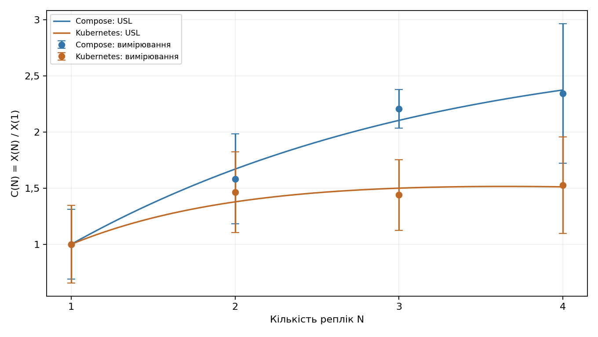
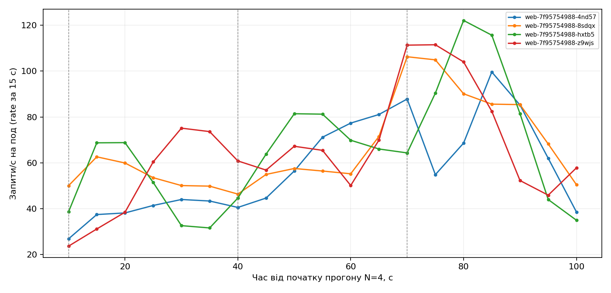
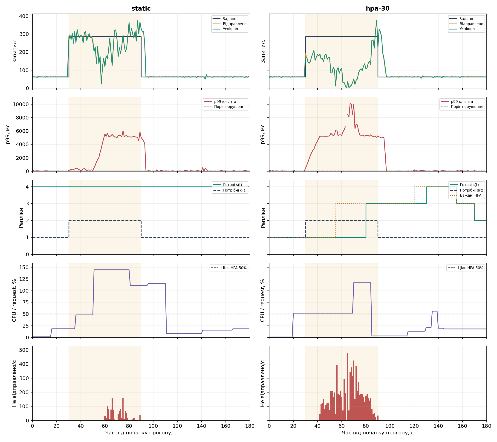
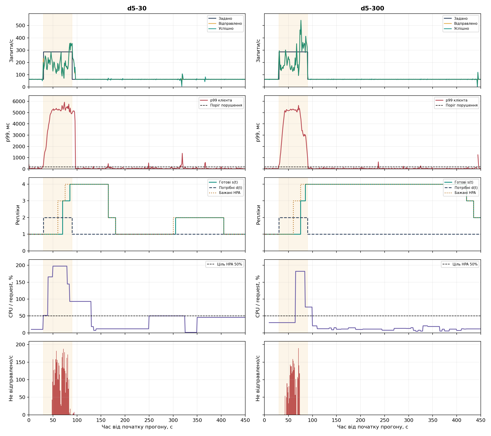

# Числові результати лабораторної роботи 3

## Фіксована кількість реплік

| N | X(N), запитів/с | Розкид | Сходинка | p99 клієнта, мс | p99 сервера, мс | CFS середнє, % | CFS максимум, % | I |
| --- | --- | --- | --- | --- | --- | --- | --- | --- |
| 1 | 208,200 | 72,046 | 600 | 5572,056 | 397,500 | 4,667 | 4,667 | 1,000 |
| 2 | 304,800 | 75,055 | 600 | 5259,000 | 247,212 | 6,132 | 6,159 | 1,013 |
| 3 | 299,650 | 65,788 | 400 | 5197,973 | 233,059 | 2,971 | 3,715 | 1,054 |
| 4 | 318,200 | 89,505 | 400 | 5216,269 | 241,369 | 0,770 | 1,429 | 1,048 |

## Відправлення на кожній сходинці

| N | Задано/с | Відправлено/с | Успішно/с | p95 відставання, мс | Не відправлено у вікні | HTTP не 2xx | Тайм-аути | Помилки з’єднання |
| --- | --- | --- | --- | --- | --- | --- | --- | --- |
| 1 | 200 | 194,150 | 194,150 | 1512,149 | 0 | 0 | 0 | 0 |
| 1 | 400 | 146,350 | 146,350 | 4995,542 | 4793 | 0 | 0 | 0 |
| 1 | 600 | 208,200 | 208,200 | 4997,056 | 7854 | 0 | 0 | 0 |
| 2 | 200 | 199,200 | 198,400 | 505,216 | 0 | 0 | 0 | 0 |
| 2 | 400 | 225,050 | 225,050 | 4995,519 | 3441 | 0 | 0 | 0 |
| 2 | 600 | 304,800 | 304,800 | 4996,570 | 5954 | 0 | 0 | 0 |
| 3 | 200 | 198,550 | 198,250 | 217,692 | 0 | 0 | 0 | 0 |
| 3 | 400 | 299,650 | 299,650 | 4988,268 | 969 | 0 | 0 | 0 |
| 3 | 600 | 239,250 | 239,250 | 4996,933 | 7302 | 0 | 0 | 0 |
| 4 | 200 | 200,000 | 198,950 | 11,494 | 0 | 0 | 0 | 0 |
| 4 | 400 | 318,200 | 318,200 | 4984,547 | 1086 | 0 | 0 | 0 |
| 4 | 600 | 233,400 | 233,400 | 4997,016 | 7243 | 0 | 0 | 0 |

## Остання сходинка

| N | Задано/с | Досягнуто/с | Досягнуто / задано | Критерій ≥ 0,9 |
| --- | --- | --- | --- | --- |
| 1 | 600 | 208,200 | 0,347 | ні |
| 2 | 600 | 304,800 | 0,508 | ні |
| 3 | 600 | 239,250 | 0,399 | ні |
| 4 | 600 | 233,400 | 0,389 | ні |

## Зайнятість каналів генератора

| N | Середній час після відправки, мс | Зайнято каналів у середньому | Максимум із 32 |
| --- | --- | --- | --- |
| 1 | 153,207 | 31,845 | 32 |
| 2 | 104,986 | 31,825 | 32 |
| 3 | 106,487 | 31,935 | 32 |
| 4 | 100,145 | 31,950 | 32 |

Зайнятість відновлено за інтервалами [sent, done) кожні 0,1 с у вікні максимуму. Це опис виконаного прогону, а не окрема перевірка закону Літтла.

## Крайні за навантаженням поди

| N | Под | Запитів/с | p99 сервера, мс | CFS, % |
| --- | --- | --- | --- | --- |
| 2 | web-7f95754988-z9wjs | 150,450 | 246,574 | 6,159 |
| 2 | web-7f95754988-hxtb5 | 154,350 | 247,780 | 6,105 |
| 3 | web-7f95754988-z9wjs | 92,400 | 157,929 | 1,972 |
| 3 | web-7f95754988-4nd57 | 105,250 | 225,430 | 3,226 |
| 4 | web-7f95754988-4nd57 | 74,250 | 354,167 | 0,604 |
| 4 | web-7f95754988-z9wjs | 83,400 | 191,306 | 1,049 |

## Інтервали оцінки CFS

| N | Под | Початок, с | Кінець, с | Тривалість, с | Періоди | Обмежені періоди |
| --- | --- | --- | --- | --- | --- | --- |
| 1 | web-7f95754988-z9wjs | 76,491 | 108,077 | 31,586 | 300 | 14 |
| 2 | web-7f95754988-hxtb5 | 72,192 | 108,975 | 36,783 | 344 | 21 |
| 2 | web-7f95754988-z9wjs | 78,067 | 106,188 | 28,121 | 276 | 17 |
| 3 | web-7f95754988-4nd57 | 41,503 | 79,076 | 37,573 | 372 | 12 |
| 3 | web-7f95754988-hxtb5 | 46,589 | 79,893 | 33,304 | 323 | 12 |
| 3 | web-7f95754988-z9wjs | 41,925 | 77,400 | 35,475 | 355 | 7 |
| 4 | web-7f95754988-4nd57 | 41,802 | 75,493 | 33,691 | 331 | 2 |
| 4 | web-7f95754988-8sdqx | 41,999 | 76,067 | 34,068 | 341 | 0 |
| 4 | web-7f95754988-hxtb5 | 31,790 | 80,776 | 48,986 | 490 | 7 |
| 4 | web-7f95754988-z9wjs | 45,378 | 74,110 | 28,732 | 286 | 3 |

## Порівняння з Compose

| N | X Compose | C Compose | X Kubernetes | C Kubernetes |
| --- | --- | --- | --- | --- |
| 1 | 270,333 | 1,000 | 208,200 | 1,000 |
| 2 | 427,800 | 1,582 | 304,800 | 1,464 |
| 3 | 596,733 | 2,207 | 299,650 | 1,439 |
| 4 | 633,867 | 2,345 | 318,200 | 1,528 |

Kubernetes: σ = 0,353561, κ = 0,048736, N* = 3,642.

## Еластичність

| Режим | T, с | θ_U | θ_O | a_U | a_O | W, под·с | Секунд понад поріг |
| --- | --- | --- | --- | --- | --- | --- | --- |
| static | 180 | 0,000 | 1,000 | 0,000 | 2,667 | 720 | 62 |
| hpa-30 | 180 | 0,278 | 0,556 | 0,278 | 1,139 | 395 | 68 |
| d5-30 | 450 | 0,089 | 0,467 | 0,089 | 0,811 | 835 | 83 |
| d5-300 | 450 | 0,100 | 0,833 | 0,100 | 2,344 | 1520 | 67 |

## Усі заплановані спроби профілів

| Режим | Заплановано | Відправлено | 2xx | HTTP не 2xx | Тайм-аути | Помилки з’єднання | Не відправлено |
| --- | --- | --- | --- | --- | --- | --- | --- |
| static | 24679 | 23505 | 23505 | 0 | 0 | 0 | 1174 |
| hpa-30 | 24679 | 16253 | 16243 | 0 | 10 | 0 | 8426 |
| d5-30 | 41543 | 37165 | 37165 | 0 | 0 | 0 | 4378 |
| d5-300 | 41543 | 38651 | 38651 | 0 | 0 | 0 | 2892 |

Ця таблиця охоплює спроби за запланованим часом, включно із завершенням після T. Не відправлені спроби не є HTTP-відповідями. Графіки інтенсивності використовують час фактичної події, тому завершення запитів зі стрибка можуть потрапляти на початок спаду.

## Спроби за фазами профілів

| Режим | Фаза, с | Заплановано | 2xx | HTTP не 2xx | Тайм-аути | Не відправлено |
| --- | --- | --- | --- | --- | --- | --- |
| static | 0–30 | 1874 | 1874 | 0 | 0 | 0 |
| static | 30–90 | 17183 | 16009 | 0 | 0 | 1174 |
| static | 90–180 | 5622 | 5622 | 0 | 0 | 0 |
| hpa-30 | 0–30 | 1874 | 1874 | 0 | 0 | 0 |
| hpa-30 | 30–90 | 17183 | 8747 | 0 | 10 | 8426 |
| hpa-30 | 90–180 | 5622 | 5622 | 0 | 0 | 0 |
| d5-30 | 0–30 | 1874 | 1874 | 0 | 0 | 0 |
| d5-30 | 30–90 | 17183 | 12805 | 0 | 0 | 4378 |
| d5-30 | 90–450 | 22486 | 22486 | 0 | 0 | 0 |
| d5-300 | 0–30 | 1874 | 1874 | 0 | 0 | 0 |
| d5-300 | 30–90 | 17183 | 14291 | 0 | 0 | 2892 |
| d5-300 | 90–450 | 22486 | 22486 | 0 | 0 | 0 |

## Час реакції HPA

| Режим | Зміна desired, с | Максимум ready під час стрибка, с | Формальний критерій p99, с | Перше зменшення після стрибка, с |
| --- | --- | --- | --- | --- |
| hpa-30 | 25 | не досягнуто | 0 | 65 |
| d5-30 | 30 | 55 | 0 | 75 |
| d5-300 | 30 | 55 | 0 | 330 |

Події виміряно від початку стрибка, крім зменшення — від його кінця. Крок спостереження метрик — 5 с. Значення 0 для критерію p99 означає лише перший десятисекундний відрізок нижче порогу; воно не гарантує збереження такого p99 далі.

Поріг порушення: 182,618 мс. Поріг критерію p99 HPA: 6294,702 мс.

